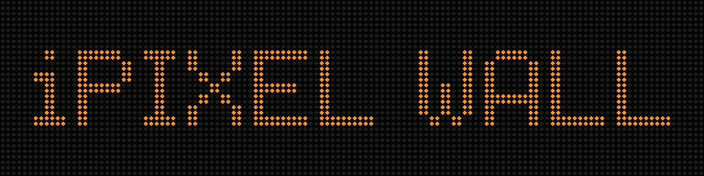
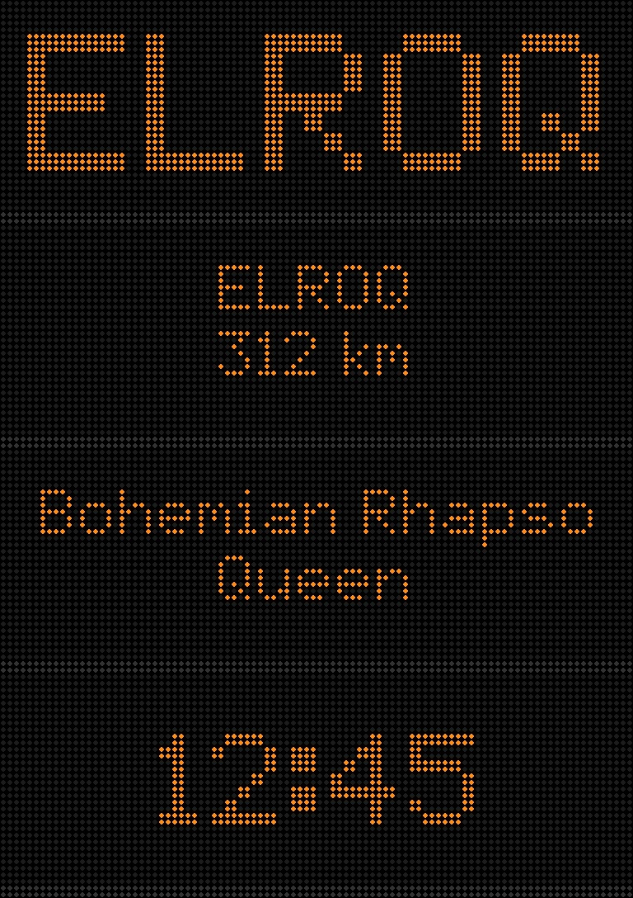
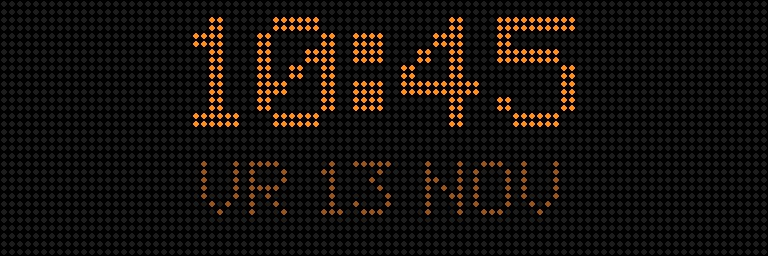
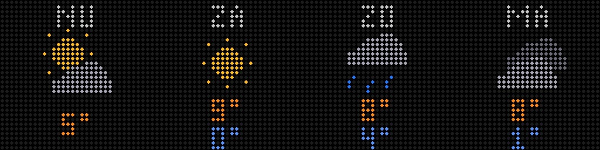

# iPIXEL Wall for Home Assistant

[Nederlands](README.nl.md) | **English**



A custom integration that combines **3 or 4 separate iPIXEL Color panels (32x32)** into a
single display of **96x32** or **128x32** pixels, the size of a pinball DMD.
Text, images, animations, a clock, the weather and a rain radar span all panels, and animations
stay **in sync**.

## Features

| Feature | In short |
|---|---|
| **3 or 4 panels** | 96 or 128 pixels wide; everything scales automatically |
| **DMD font** | Pixel font with accents, € and °; as large as possible, or a fixed size |
| **Synchronised animations** | GIFs are streamed frame by frame from Home Assistant, so all panels stay in step |
| **Sources** | Media browser files, http(s) URLs, camera entities, weather entities, a built-in clock |
| **Crop and scale** | For example only the top half of a rain radar |
| **Transitions** | wipe, slide, dissolve or drop between two items |
| **Weather forecast** | Pixel-art weather icons with the forecast per panel |
| **DMD clock** | Blinking colon, optionally with the date |
| **Dashboard preview** | Camera entities that show the wall as an LED board, as a 3-panel and a 4-panel version |
| **Boot memory** | Buttons to erase old images stored on the panels |

<p>
  
  
  
</p>

## Requirements

- Home Assistant **2024.8** or newer
- The **[iPIXEL Color](https://github.com/cagcoach/ha-ipixel-color)** integration, with every
  panel added and working
- 3 or 4 **32x32** iPIXEL Color panels within Bluetooth range of Home Assistant

## Quick start

1. Install the integration: see **[Installation](docs/en/installation.md)**.
2. Go to **Settings → Devices & services → Add integration → iPIXEL Wall** and pick the panels
   from left to right. Panel 4 is optional.
3. Try it in **Developer tools → Actions**:

```yaml
action: text.set_value
target:
  entity_id: text.ipixel_wall_display
data:
  value: "Hello world"
```

```yaml
action: media_player.play_media
target:
  entity_id: media_player.ipixel_wall_media
data:
  media_content_id: clock
  media_content_type: image/gif
```

## Documentation

| Topic | |
|---|---|
| [Installation and updating](docs/en/installation.md) | HACS, manual, Umbrel, adding a 4th panel |
| [Usage](docs/en/usage.md) | All entities, media sources, options, text and transitions |
| [Automations](docs/en/automations.md) | A complete "attract mode" rotation and building blocks |
| [Dashboard](docs/en/dashboard.md) | Preview cameras, cards and showing the wall on a TV |
| [How it works](docs/en/how-it-works.md) | Synchronisation, Bluetooth limits, settings in `const.py` |
| [Troubleshooting](docs/en/troubleshooting.md) | Common errors and how to fix them |
| [Changelog](CHANGELOG.md) | Version history |

The integration's user interface is available in English and Dutch. The example automations
use Dutch entity names and texts; adapt them to your own setup.

## License

MIT; see [LICENSE](LICENSE). For third-party parts, see [NOTICE.md](NOTICE.md).
