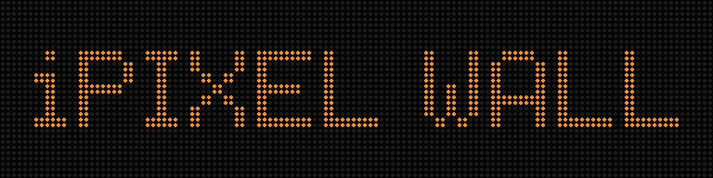
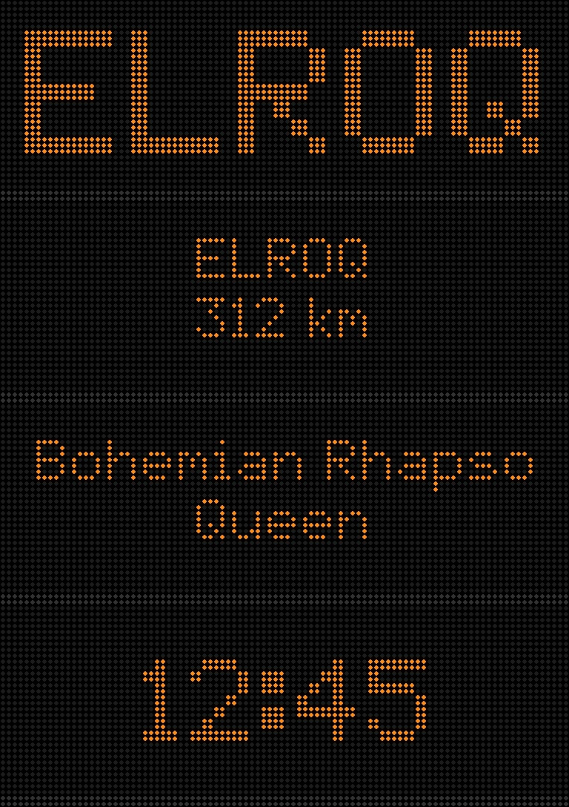
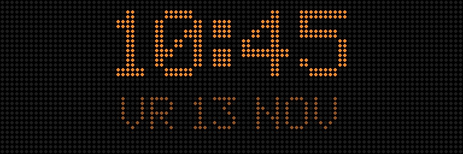
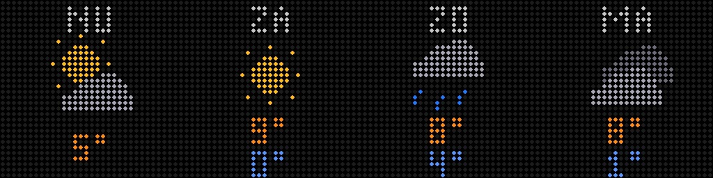

# iPIXEL Wall voor Home Assistant

**Nederlands** | [English](README.md)



Een custom integratie die **3 of 4 losse iPIXEL Color-panelen (32x32)** samenvoegt tot één
display van **96x32** of **128x32** pixels: precies het formaat van een pinball-DMD.
Tekst, plaatjes, animaties, de klok, het weer en de buienradar lopen over alle panelen,
en animaties blijven **synchroon**.

## Wat kan het?

| Functie | Kort |
|---|---|
| **3 of 4 panelen** | Breedte 96 of 128 pixels; alles schaalt automatisch mee |
| **DMD-lettertype** | Pixellettertype met accenten, € en °; automatisch zo groot mogelijk of vaste grootte |
| **Synchrone animaties** | GIF's worden frame voor frame vanuit Home Assistant gestreamd, zodat alle panelen gelijk lopen |
| **Bronnen** | Bestanden uit de mediabrowser, http(s)-URL's, camera-entiteiten, weer-entiteiten, ingebouwde klok |
| **Uitsnijden en schalen** | Bijvoorbeeld alleen de bovenste helft van de buienradar |
| **Overgangen** | wipe, slide, dissolve of drop tussen twee onderdelen |
| **Weerbericht** | Pixel-art weericonen met de verwachting per paneel |
| **DMD-klok** | Knipperende dubbele punt, optioneel met de datum |
| **Voorbeeld in je dashboard** | Camera-entiteiten die de wall als LED-bord tonen, ook als 3- én 4-panelenversie |
| **Opstartgeheugen** | Knoppen om oude, op de panelen opgeslagen plaatjes te wissen |

<p>
  
  
  
</p>

## Vereisten

- Home Assistant **2024.8** of nieuwer
- De integratie **[iPIXEL Color](https://github.com/cagcoach/ha-ipixel-color)**, met elk paneel
  daarin toegevoegd en werkend
- 3 of 4 iPIXEL Color-panelen van **32x32**, binnen Bluetooth-bereik van Home Assistant

## Snel aan de slag

1. Installeer de integratie: zie **[Installatie](docs/nl/installatie.md)**.
2. Ga naar **Instellingen → Apparaten & diensten → Integratie toevoegen → iPIXEL Wall** en kies
   de panelen van links naar rechts. Paneel 4 is optioneel.
3. Probeer het uit via **Ontwikkelhulpmiddelen → Acties**:

```yaml
action: text.set_value
target:
  entity_id: text.ipixel_wall_display
data:
  value: "Hallo wereld"
```

```yaml
action: media_player.play_media
target:
  entity_id: media_player.ipixel_wall_media
data:
  media_content_id: clock
  media_content_type: image/gif
```

## Documentatie

| Onderwerp | |
|---|---|
| [Installatie en updaten](docs/nl/installatie.md) | HACS, handmatig, Umbrel, 4e paneel toevoegen |
| [Gebruik](docs/nl/gebruik.md) | Alle entiteiten, mediabronnen, opties, teksten en overgangen |
| [Automatiseringen](docs/nl/automatiseringen.md) | Een complete "attract mode"-rotatie en losse bouwblokken |
| [Dashboard](docs/nl/dashboard.md) | Voorbeeldcamera's, kaarten en tonen op de tv |
| [Hoe het werkt](docs/nl/techniek.md) | Synchronisatie, Bluetooth-grenzen, instellingen in `const.py` |
| [Problemen oplossen](docs/nl/problemen.md) | Veelvoorkomende fouten en hoe je ze oplost |
| [Wijzigingen](CHANGELOG.nl.md) | Versiegeschiedenis |

De gebruikersinterface van de integratie is beschikbaar in het Nederlands en Engels.

## Licentie

MIT; zie [LICENSE](LICENSE). Voor onderdelen van derden, zie [NOTICE.md](NOTICE.md).
