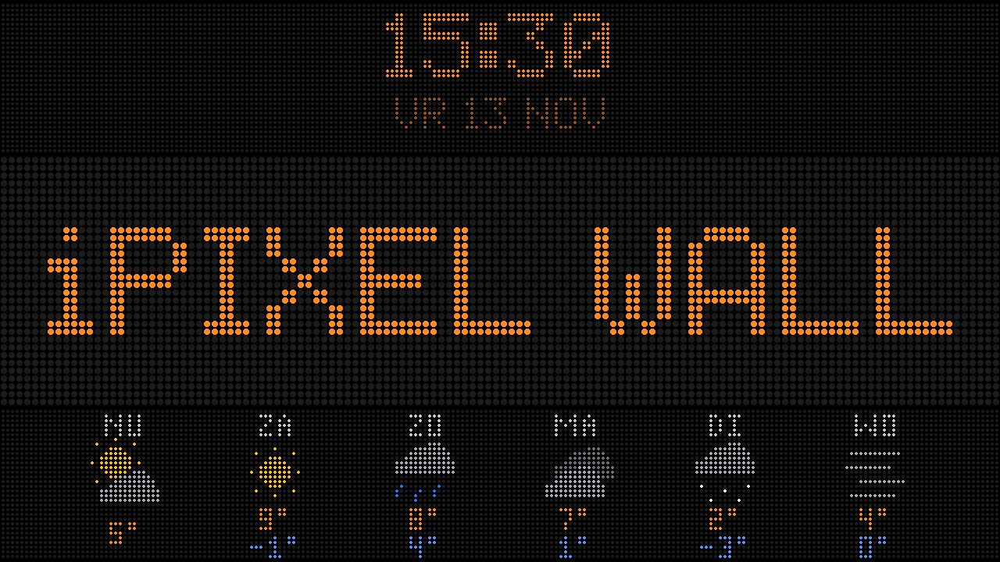

# Dashboard

[← Back to the README](../../README.md) · [Nederlands](../nl/dashboard.md) | **English**

## Preview cameras

The integration creates three camera entities that show what's on the wall, as a board of round
LEDs:

| Entity | Width |
|---|---|
| `camera.ipixel_wall_preview` | As the wall is currently configured |
| `camera.ipixel_wall_preview_3_panelen` | Always 96x32 |
| `camera.ipixel_wall_preview_4_panelen` | Always 128x32 |

- **The other width is rebuilt, not stretched.** Text is laid out again, the clock and weather
  gain or lose a column, and images are scaled to fit. That way you can see in advance how
  everything will look on 4 panels.
- **Cost:** the preview is calculated in Home Assistant and uses no Bluetooth. The other width is
  only calculated when that card is actually being viewed.
- **Sync:** for streamed animations the preview follows the actual position of the stream. A
  fixed delay of a fraction of a second comes from the browser.
- **Transitions** aren't shown in the preview; it jumps straight to the new image.

```yaml
type: picture-entity
entity: camera.ipixel_wall_preview_4_panelen
camera_view: live        # without this line the card only refreshes every 10 seconds
show_name: false
show_state: false
```

More cards are in **[examples/dashboard.yaml](../../examples/dashboard.yaml)**.

## On a TV

### TV view (16:9)



`camera.ipixel_wall_preview_tv` fills a 16:9 screen without distortion: the clock with date on
top, the wall (as 4 panels) in the middle and the weather forecast below. The weather uses the
first weather entity it finds; set another one with `TV_WEATHER_ENTITY` in `const.py`. The
forecast is refreshed every 15 minutes.

```yaml
title: Wall
path: wall-tv
type: panel
cards:
  - type: picture-entity
    entity: camera.ipixel_wall_preview_tv
    camera_view: live
    show_name: false
    show_state: false
```

### Google TV / Android TV

There's no official Home Assistant app for Google TV. What works:

- **A dashboard app for the TV**, such as *Wall Dashboard* or *HA TV Dashboard*, with a
  full-screen view (see the bottom card in `examples/dashboard.yaml`).
- **Fully Kiosk Browser** with the Plus licence, plus the Fully Kiosk integration. A button in
  Home Assistant can then make the TV open a page, even over http.

### Casting

`cast.show_lovelace_view` only works when Home Assistant is reachable over **https**, with
Home Assistant Cloud or your own domain with a certificate. Otherwise you get *"Home Assistant
Cast requires your instance to be reachable via HTTPS"*.

The wall is 3:1 or 4:1, so on a 16:9 screen you see a wide strip with black above and below.
