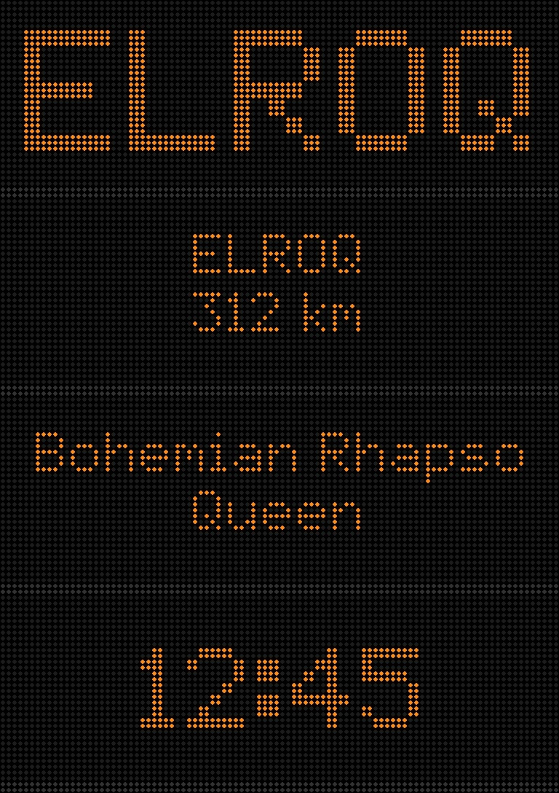
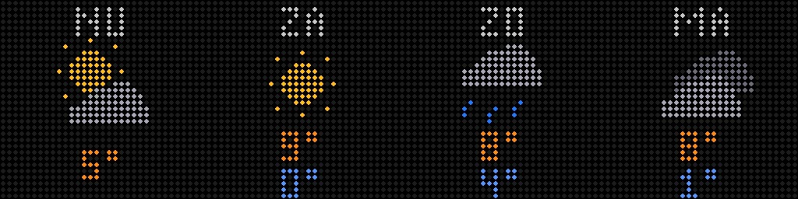
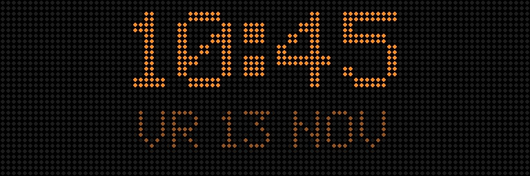
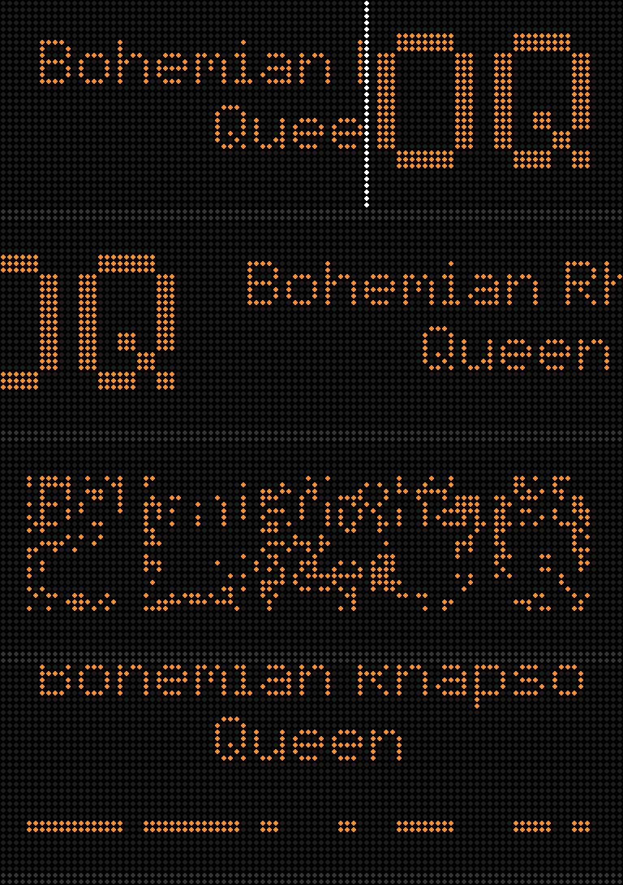

# Usage

[← Back to the README](../../README.md) · [Nederlands](../nl/gebruik.md) | **English**

## Entities

The names below are the defaults. Check them under the **iPIXEL Wall** device.

| Entity | Purpose |
|---|---|
| `text.ipixel_wall_display` | Show text |
| `media_player.ipixel_wall_media` | Show images, GIFs, cameras, weather and the clock; **stop** turns the wall black |
| `select.ipixel_wall_display_mode` | `static` (still text) or `scroll` (marquee) |
| `select.ipixel_wall_transition` | Transition between items: `none`, `wipe`, `slide`, `dissolve` (default), `drop` |
| `number.ipixel_wall_scroll_frame_interval` | Marquee speed |
| `number.ipixel_wall_frametijd_animaties` | "Animation frame time": minimum ms per frame for GIFs and transitions (default 150). Lower = smoother, but frames may arrive late. Takes effect from the next item |
| `light.ipixel_wall_text_color` | Text colour (also used by the clock) |
| `light.ipixel_wall_background_color` | Background colour |
| `camera.ipixel_wall_preview` | Preview of the wall as configured |
| `camera.ipixel_wall_preview_3_panelen` | Preview at 96x32, regardless of the configuration |
| `camera.ipixel_wall_preview_4_panelen` | Preview at 128x32, regardless of the configuration |
| `camera.ipixel_wall_preview_tv` | 16:9 TV view: clock, the wall (4 panels) and weather |
| `button.ipixel_wall_opstartbeeld_zwart_maken` | "Make boot screen black": erases stored slots 1-16 and stores a black boot image |
| `button.ipixel_wall_paneelgeheugen_volledig_wissen` | "Erase panel memory completely": erases **everything** on the panels, including their settings |

## Text

```yaml
action: text.set_value
target:
  entity_id: text.ipixel_wall_display
data:
  value: "ELROQ 312 km"
```



All text uses a **DMD pixel font**. A prefix sets the style:

| Text | Result |
|---|---|
| `ELROQ` | No prefix: as large as possible (3×, 2× or 1×). Too long? Then over 2 lines. |
| `[vast]Bohemian Rhapso` | Always the same small font: about 15 characters per line on 3 panels, about 21 on 4 |
| `[vast]ELROQ\|312 km` | `\|` splits the text over **2 lines** (works with `[vast]` and `[fs=N]`) |
| `[fs=2]12:45` | Fixed scale 1, 2 or 3 |
| `[ttf]Hello` | The old smooth font of iPIXEL Color |

(`vast` is Dutch for "fixed".)

- **Supported characters:** ASCII, €, °, ⚡ (lightning/charging) and 🔋 (battery), and accents on lowercase letters (België, café).
  Typographic quotes and dashes are converted. Unknown characters become `?`.
- **Text that is too long** is cut off on the right. Shorten long texts in your template, for
  example with `wordwrap` (see [Automations](automations.md)).
- In `scroll` mode the text runs as a marquee at 2× size.

## Media

```yaml
action: media_player.play_media
target:
  entity_id: media_player.ipixel_wall_media
data:
  media_content_id: <source>
  media_content_type: image/gif     # or image/png, image/jpeg
  extra:                            # optional
    crop: top
```

### Sources

| `media_content_id` | Shows |
|---|---|
| `media-source://media_source/local/folder/file.gif` | A file from the media browser |
| `https://…/image.png` | An image or GIF from the internet (max. 10 MB) |
| `camera.buienradar` | The current image of a camera entity, including animation |
| `weather.forecast_home` | Weather forecast: column 1 = now, then the coming days (see below) |
| `clock` | DMD clock with date |
| `clock:big` | Time only, extra large |

### Options under `extra`

| Option | Values | Effect |
|---|---|---|
| `crop` | `top`, `bottom`, `left`, `right` or `[left, top, right, bottom]` as fractions 0-1 | First cuts out part of the source, for example `[0, 0, 1, 0.33]` = top third |
| `panel` | `1`-`4` | With `fit`: centre the image on this panel (1 = leftmost) instead of the middle of the wall, e.g. for a square photo |
| `resize_mode` | `fit` (default) or `crop` | `fit` = everything visible with black bars; `crop` = fill the wall, edges are cut off |
| `stream` | `true` / `false` | Stream a GIF (default, synchronised) or upload it as a single GIF (smoother, not synchronised) |
| `transition` | `none`, `wipe`, `slide`, `dissolve`, `drop` | Transition for this item only |

### Weather forecast



Column 1 shows the current weather and temperature. The next columns show the coming days, with
the day, an icon, the maximum temperature (orange) and the minimum temperature (blue). Works with
any weather entity that provides a daily forecast. Day names are Dutch (MA, DI, WO …).

### Clock



The colon blinks. The time is taken when the clock appears, so don't leave it on screen for more
than about a minute.

### GIF tips

- **Size:** make GIFs exactly **96x32** or **128x32** (128x32 is the size of a real pinball DMD)
  and use few colours, ideally 16. That saves processing and Bluetooth.
- **Maximum number of frames:** 2500 (`MAX_GIF_FRAMES` in `const.py`).
- **When streaming** every frame lasts at least 150 ms (about 6-7 frames per second), because the panels can't update faster.
  Shorter frames are merged; the total duration stays the same.

## Transitions



*Top to bottom: wipe, slide, dissolve, drop (halfway through).*

- **For everything:** pick the transition with `select.ipixel_wall_transition`. The choice is kept
  after a restart.
- **Per item:** use `extra.transition` with `play_media`.
- **Text and images** are done when the transition ends, without a separate upload.
- **The marquee** has no transition.

## Boot screen

The panels keep images that were once stored with the iPIXEL app and show them after powering on.
To make them black:

1. Briefly disable automations that drive the wall.
2. Press **Opstartbeeld zwart maken** ("make boot screen black"). This takes up to about a minute.
3. Still seeing old images after switching off and on? Use **Paneelgeheugen volledig wissen**
   ("erase panel memory completely"). This also resets the panel settings, such as brightness.
   Set those again in iPIXEL Color afterwards.
