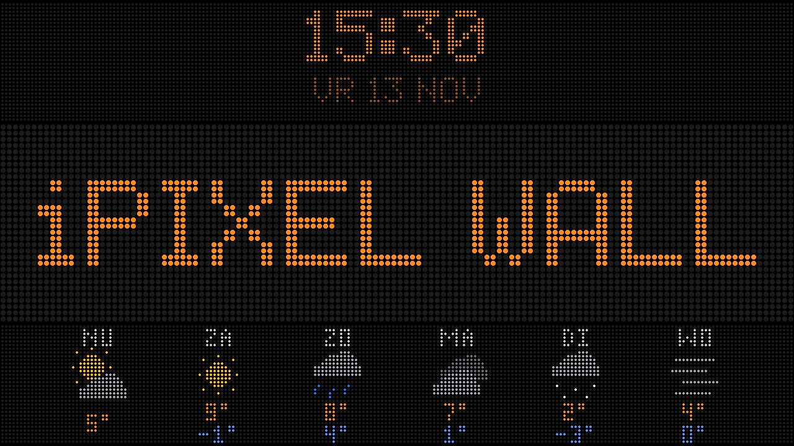

# Dashboard

[← Terug naar de README](../../README.nl.md) · **Nederlands** | [English](../en/dashboard.md)

## Voorbeeldcamera's

De integratie maakt drie camera-entiteiten die laten zien wat er op de wall staat, als een bord
met ronde LED's:

| Entiteit | Breedte |
|---|---|
| `camera.ipixel_wall_preview` | Zoals de wall nu is ingesteld |
| `camera.ipixel_wall_preview_3_panelen` | Altijd 96x32 |
| `camera.ipixel_wall_preview_4_panelen` | Altijd 128x32 |

- **De andere breedte wordt opnieuw opgebouwd, niet uitgerekt.** Tekst wordt opnieuw opgemaakt,
  de klok en het weer krijgen een kolom erbij of eraf, en plaatjes worden passend geschaald. Zo
  zie je vooraf hoe alles op 4 panelen wordt.
- **Kosten:** het voorbeeld wordt in Home Assistant berekend en kost geen Bluetooth. De andere
  breedte wordt alleen berekend als die kaart echt bekeken wordt.
- **Synchronisatie:** bij gestreamde animaties volgt het voorbeeld de werkelijke positie van de
  stream. Een vaste vertraging van een fractie van een seconde komt door de browser.
- **Overgangen** zijn in het voorbeeld niet te zien; dat springt direct naar het nieuwe beeld.

```yaml
type: picture-entity
entity: camera.ipixel_wall_preview_4_panelen
camera_view: live        # zonder deze regel ververst de kaart maar eens per 10 seconden
show_name: false
show_state: false
```

Meer kaarten staan in **[examples/dashboard.yaml](../../examples/dashboard.yaml)**.

## Op de tv

### Tv-weergave (16:9)



`camera.ipixel_wall_preview_tv` vult een 16:9-scherm zonder vervorming: de klok met datum
bovenaan, de wall (als 4 panelen) in het midden en het weerbericht eronder. Het weer gebruikt
de eerste weer-entiteit die hij vindt; kies een andere met `TV_WEATHER_ENTITY` in `const.py`.
De verwachting wordt elke 15 minuten ververst.

```yaml
title: Wall
path: wall-tv
type: panel
cards:
  - type: picture-entity
    entity: camera.ipixel_wall_preview_tv
    camera_view: live
    show_name: false
    show_state: false
```

### Google TV / Android TV

Er is geen officiële Home Assistant-app voor Google TV. Wat werkt:

- **Een dashboard-app voor de tv**, zoals *Wall Dashboard* of *HA TV Dashboard*, met een
  schermvullende weergave (zie de onderste kaart in `examples/dashboard.yaml`).
- **Fully Kiosk Browser** met de Plus-licentie, plus de Fully Kiosk-integratie. Daarmee kan een
  knop in Home Assistant de tv een pagina laten openen, ook via http.

### Casten

`cast.show_lovelace_view` werkt alleen als Home Assistant via **https** bereikbaar is, met
Home Assistant Cloud of een eigen domein met certificaat. Anders krijg je *"Home Assistant Cast
requires your instance to be reachable via HTTPS"*.

De wall is 3:1 of 4:1. Op een 16:9-scherm zie je dus een brede strook met zwart erboven en
eronder.
