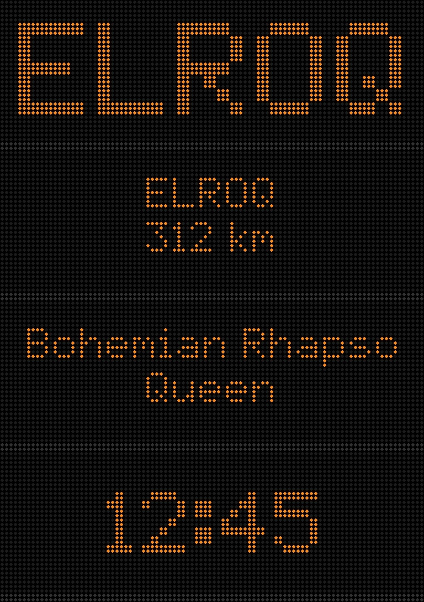
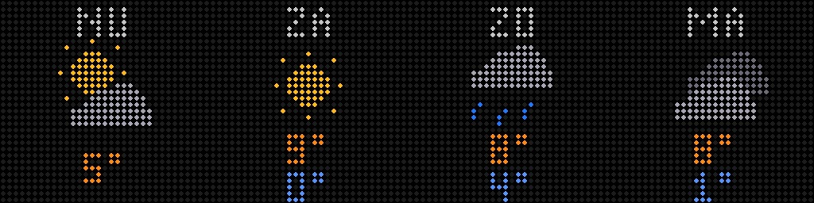
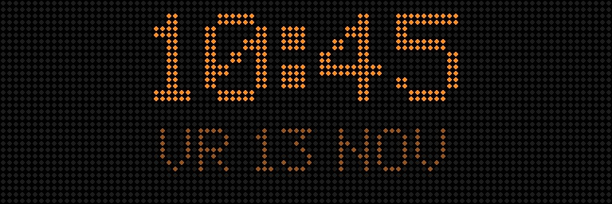
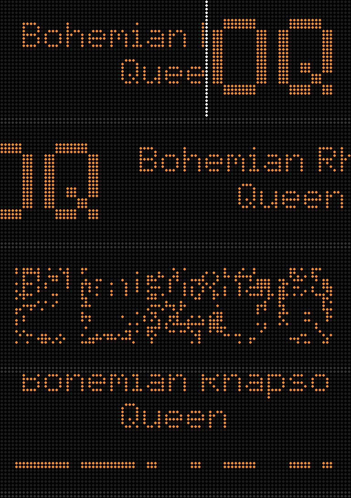

# Gebruik

[← Terug naar de README](../../README.nl.md) · **Nederlands** | [English](../en/usage.md)

## Entiteiten

De namen hieronder zijn de standaardnamen. Controleer ze onder het apparaat **iPIXEL Wall**.

| Entiteit | Doel |
|---|---|
| `text.ipixel_wall_display` | Tekst tonen |
| `media_player.ipixel_wall_media` | Plaatjes, GIF's, camera, weer en klok tonen; **stoppen** maakt de wall zwart |
| `select.ipixel_wall_display_mode` | `static` (stilstaande tekst) of `scroll` (lichtkrant) |
| `select.ipixel_wall_transition` | Overgang tussen onderdelen: `none`, `wipe`, `slide`, `dissolve` (standaard), `drop` |
| `number.ipixel_wall_frametijd_animaties` | Minimale tijd per frame voor GIF's en overgangen (standaard 150 ms). Lager = vloeiender, maar frames kunnen te laat komen. Geldt vanaf het volgende item |
| `number.ipixel_wall_scroll_frame_interval` | Snelheid van de lichtkrant |
| `light.ipixel_wall_text_color` | Tekstkleur (ook voor de klok) |
| `light.ipixel_wall_background_color` | Achtergrondkleur |
| `camera.ipixel_wall_preview` | Voorbeeld van de wall zoals ingesteld |
| `camera.ipixel_wall_preview_3_panelen` | Voorbeeld op 96x32, ongeacht de instelling |
| `camera.ipixel_wall_preview_4_panelen` | Voorbeeld op 128x32, ongeacht de instelling |
| `camera.ipixel_wall_preview_tv` | Tv-weergave 16:9: klok, de wall (4 panelen) en het weer |
| `button.ipixel_wall_opstartbeeld_zwart_maken` | Wist opgeslagen plekken 1-16 en zet een zwart opstartbeeld |
| `button.ipixel_wall_paneelgeheugen_volledig_wissen` | Wist **alles** op de panelen, inclusief instellingen |

## Tekst

```yaml
action: text.set_value
target:
  entity_id: text.ipixel_wall_display
data:
  value: "ELROQ 312 km"
```



Alle tekst gebruikt een **DMD-pixellettertype**. Met een voorvoegsel bepaal je de stijl:

| Tekst | Resultaat |
|---|---|
| `ELROQ` | Zonder voorvoegsel: zo groot mogelijk (3×, 2× of 1×). Te lang? Dan over 2 regels. |
| `[vast]Bohemian Rhapso` | Altijd dezelfde kleine letter: ±15 tekens per regel op 3 panelen, ±21 op 4 |
| `[vast]ELROQ\|312 km` | `\|` splitst over **2 regels** (werkt met `[vast]` en `[fs=N]`) |
| `[fs=2]12:45` | Vaste vergroting 1, 2 of 3 |
| `[ttf]Hallo` | Het oude, gladde lettertype van iPIXEL Color |

- **Ondersteunde tekens:** ASCII, €, °, ⚡ (bliksem/laden), 🔋 (accu) en ☀ (zon), en accenten op kleine letters (België, café). Typografische
  aanhalingstekens en gedachtestreepjes worden omgezet. Onbekende tekens worden een `?`.
- **Te lange tekst** wordt rechts afgekapt. Knip lange teksten in je template, bijvoorbeeld met
  `wordwrap` (zie [Automatiseringen](automatiseringen.md)).
- In `scroll`-modus loopt de tekst als lichtkrant op 2× grootte.

## Media

```yaml
action: media_player.play_media
target:
  entity_id: media_player.ipixel_wall_media
data:
  media_content_id: <bron>
  media_content_type: image/gif     # of image/png, image/jpeg
  extra:                            # optioneel
    crop: top
```

### Bronnen

| `media_content_id` | Toont |
|---|---|
| `media-source://media_source/local/map/bestand.gif` | Een bestand uit de mediabrowser |
| `https://…/plaatje.png` | Een plaatje of GIF van internet (max. 10 MB) |
| `camera.buienradar` | Het huidige beeld van een camera-entiteit, inclusief animatie |
| `weather.forecast_home` | Weerbericht: kolom 1 = nu, daarna de komende dagen (zie hieronder) |
| `clock` | DMD-klok met datum |
| `clock:big` | Alleen de tijd, extra groot |

### Opties onder `extra`

| Optie | Waarden | Werking |
|---|---|---|
| `crop` | `top`, `bottom`, `left`, `right` of `[links, boven, rechts, onder]` als fracties 0-1 | Snijdt eerst een deel uit de bron, bijvoorbeeld `[0, 0, 1, 0.33]` = bovenste derde |
| `text` | tekst (zelfde voorvoegsels als bij tekst, bijv. `[vast]Titel\|Artiest`) | Zet de afbeelding op één paneel (`panel`, standaard 1) en de tekst ernaast, bijv. een artiestfoto met het nummer |
| `panel` | `1`-`4` | Bij `fit`: zet het beeld midden op dit paneel (1 = meest linkse) in plaats van midden op de wall, bijv. voor een vierkante foto |
| `resize_mode` | `fit` (standaard) of `crop` | `fit` = alles zichtbaar met zwarte randen; `crop` = wall vullen, randen vallen weg |
| `stream` | `true` / `false` | Een GIF streamen (standaard, synchroon) of als losse GIF uploaden (vloeiender, niet synchroon) |
| `transition` | `none`, `wipe`, `slide`, `dissolve`, `drop` | Overgang alleen voor dit onderdeel |

### Weerbericht



Kolom 1 toont het huidige weer en de huidige temperatuur. De volgende kolommen tonen de komende
dagen, met de dag, een icoon, de maximumtemperatuur (oranje) en de minimumtemperatuur (blauw).
Werkt met elke weer-entiteit die een dagverwachting ondersteunt.

### Klok



De dubbele punt knippert. De tijd wordt bepaald op het moment dat de klok verschijnt; laat hem
daarom niet langer dan ongeveer een minuut staan.

### GIF's: tips

- **Formaat:** maak GIF's precies **96x32** of **128x32** (128x32 is het formaat van een echte
  pinball-DMD) en gebruik weinig kleuren, liefst 16. Dat scheelt rekenwerk en Bluetooth.
- **Maximaal aantal frames:** 2500 (`MAX_GIF_FRAMES` in `const.py`).
- **Bij streamen** duurt elk frame minimaal 150 ms (ongeveer 6 à 7 frames per seconde), omdat de panelen niet sneller bijwerken.
  Kortere frames worden samengevoegd; de totale duur blijft gelijk.

## Overgangen



*Van boven naar beneden: wipe, slide, dissolve, drop (moment halverwege).*

- **Voor alles:** kies de overgang met `select.ipixel_wall_transition`. De keuze blijft bewaard
  na een herstart.
- **Per onderdeel:** gebruik `extra.transition` bij `play_media`.
- **Tekst en plaatjes** zijn na de overgang meteen klaar, zonder aparte upload.
- **De lichtkrant** heeft geen overgang.

## Opstartbeeld

De panelen bewaren beelden die ooit via de iPIXEL-app zijn opgeslagen en tonen die na het
aanzetten. Zo krijg je ze zwart:

1. Zet automatiseringen die de wall aansturen even uit.
2. Druk op **Opstartbeeld zwart maken**. Dat duurt tot ongeveer een minuut.
3. Zie je na het uit- en aanzetten nog oude beelden, gebruik dan **Paneelgeheugen volledig wissen**.
   Daarbij gaan ook de instellingen van het paneel verloren, zoals de helderheid. Stel die daarna
   opnieuw in bij iPIXEL Color.
